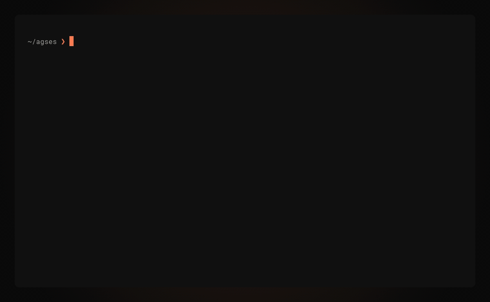

# agses

[](https://github.com/reemus-dev/agses/actions/workflows/ci.yml)



**Find, outline, read, search and rename Claude Code sessions from your
terminal, even while they run.**

Use it yourself, or let your agents use it to carry on earlier work, see what
another session did, or analyze past sessions to improve future work. `agses`
reads the transcripts Claude Code saves, with no index to build or keep current.

- List projects and sessions, newest activity first
- Outline a session as numbered events, then read any event in full
- Read across every compaction, not just the context since the last one
- Follow subagent threads and workflow runs from the parent session
- Search message text across one project or all of them
- Rename a session, as `/rename` does, even while it runs
- Get JSON output from every command that lists or reads sessions

An outline starts with the session's metadata, shortened here, then shows one
row per event:

```text
$ agses outline 0205853e93805d --no-tools --first 8
---
hexId: "0205853e93805d"
name: "Dropping the Anthropic SDK"
project: "/Users/me/agses"
---

#1  user      How much work would be required to drop the anthropic SDK as…
#42 assistant Checking whether the SDK exports a type for transcript entri…
#47 assistant Measuring what a bundle would weigh, to ground the bundling …
#52 assistant The bundle comes out at 1.3 MB, so the only question is the …
#56 assistant Bundling won't work. It would technically: a minified bundle…
#59 user      If we're going to do this, I guess golden output diff is one…
#70 assistant I agree. The golden diff only proves that the migration pres…
#72 user      Confirm your test recommendations with pi-advisor. Also, use…
… 103 later activity events omitted
```

Refs skip the tool calls that `--no-tools` hides. Then
`agses read 0205853e93805d --entry 56` prints event 56 in full.

## Installation

`agses` requires [Bun](https://bun.sh/) 1.3.7 or later. It is tested on macOS
and Linux.

```sh
bun add -g agses-cli
```

Or run it without installing:

```sh
bunx agses-cli sessions --all --limit 20
```

<details>
<summary>Shell completion for bash, zsh, fish and PowerShell</summary>

```sh
echo 'source <(agses complete bash)' >> ~/.bashrc
```

```sh
echo 'source <(agses complete zsh)' >> ~/.zshrc
```

```sh
agses complete fish > ~/.config/fish/completions/agses.fish
```

```powershell
agses complete powershell > ~/agses-completion.ps1
echo '. ~/agses-completion.ps1' >> $PROFILE
```

</details>

To uninstall, run `bun remove -g agses-cli` and remove any completion line you
added.

## Quick start

Find a session, outline its events, then read the events that matter. Replace
`SESSION` with a Hex ID from `sessions`, and `20` with a ref from the outline.

```sh
# Find the session
agses sessions --all --limit 20
# Numbered events, newest last
agses outline SESSION --last 40
# One event in full
agses read SESSION --entry 20
# Recent conversation within an estimated 80,000 tokens
agses read SESSION --no-tools --tokens 80000
# Matches with one message either side
agses search "query" --all --context 1
```

A running session shows what Claude Code has saved so far. Run the command again
to see newer activity.

### Use with agents

`agses --help` prints the commands and selection rules as a guide written for
agents. Add an instruction to the file your agent reads, such as `CLAUDE.md` or
`AGENTS.md`:

```markdown
Use `agses` when continuing earlier work, inspecting another Claude Code
session, or analyzing past sessions. Run `agses --help` first.
```

## What agses reads and writes

- `agses` reads `$CLAUDE_CONFIG_DIR/projects`, or `~/.claude/projects` when
  `CLAUDE_CONFIG_DIR` is not set. It never starts a model session.
- Only `rename` writes to the Claude Code config directory. It appends one
  `custom-title` entry to the session's transcript, as `/rename` and the Agent
  SDK's `renameSession` do. A running session shows the new name the next time
  it records its name, or when resumed.
- Everything runs locally, except `tokens`. It sends its input to Anthropic's
  token-counting API, or to `ANTHROPIC_BASE_URL` when that is set. It needs
  `AGSES_ANTHROPIC_API_KEY` or `ANTHROPIC_API_KEY`, in that order. Claude Code
  can use `ANTHROPIC_API_KEY` in place of your subscription login, so prefer
  `AGSES_ANTHROPIC_API_KEY`, which leaves Claude Code's login as it is.
  `read --tokens` estimates locally and needs no key.

## Recommended settings

Two Claude Code settings keep sessions where `agses` can find them. Merge these
keys into `~/.claude/settings.json`:

```json
{
  "cleanupPeriodDays": 365,
  "env": {
    "CLAUDE_BASH_MAINTAIN_PROJECT_WORKING_DIR": "1"
  }
}
```

- `cleanupPeriodDays` sets how many days Claude Code keeps transcripts. The
  default is 30, and Claude Code deletes older transcripts without a message.
  Set it to how long you want to keep sessions, such as `365` for a year. `0` is
  not valid.
- `CLAUDE_BASH_MAINTAIN_PROJECT_WORKING_DIR` returns each Bash command to the
  project directory. Without it, a `cd` carries over to later commands. An agent
  that moves to another directory, such as a temp directory, can then change the
  project path its session records, so the session seems to be missing from its
  project.

## Usage

```text
agses projects
agses sessions [--project PATH_OR_QUERY | --all] [--limit N] [--size]
agses outline [SESSION] [--subagent ID] [--first N | --last N]
              [--no-tools] [--extra]
agses read [SESSION] [--subagent ID] [--role user|assistant|both]
           [--no-tools] [--extra] [--first N | --last N]
           [--entry N] [--tokens N]
agses search QUERY [--project PATH_OR_QUERY | --all]
             [--role user|assistant|both] [--subagents] [--context N]
             [--regex] [--case-sensitive]
agses workflows [SESSION] [--run ID|REF]
agses rename SESSION NAME
agses tokens [FILE] [--model opus|sonnet|haiku|ID]
```

- `agses` alone runs `agses sessions`.
- Every command that takes `SESSION` also takes `--project PATH_OR_QUERY`.
- Every command that lists or reads sessions accepts `--format text|json`.
- `#N` refs in an outline number every event, including the attachment, meta and
  system entries that only `--extra` shows. A ref is the same with or without
  `--extra`. Pass it to `read --entry N`.
- `tokens` counts the tokens in a file, or stdin, for a model.
- Run `agses help` or `agses --help` for the guide, and `agses help <command>`
  for every option. `agses --version` prints the installed version.

### Session selection

Projects are the directories sessions started in, as Claude Code files them. A
session started in a git worktree belongs to the worktree path. `--project`
takes an exact path or a unique substring. Without it, `agses` uses the closest
project that contains the current directory.

`SESSION` resolves within that project, in this order:

1. A `.jsonl` path selects that session by file name. It must belong to
   `--project` when given.
2. Exactly 14 hex characters are a Hex ID, as `sessions` shows it, with no
   fallback to the other forms.
3. An exact session UUID.
4. An exact name, case-insensitive.
5. An unambiguous UUID prefix.

A session continued in a new transcript is not listed. It belongs to the project
of the session that continues it, where its path, Hex ID, UUID or UUID prefix
still selects it.

Without `--project`, a `SESSION` with no match in the current directory's
project, or given outside any project, resolves across all projects by the same
rules. An ambiguous match across projects fails and lists each candidate's
project. Pick one with `--project` or its Hex ID.

Omit `SESSION` to use the most recently active session of the project.

### Subagents and workflow runs

Outline rows that spawn, message or report back from a subagent show
`@SUBAGENT_ID`. Workflow calls and their task notifications show `@wf_RUN_ID`.

```sh
agses outline SESSION --subagent SUBAGENT_ID
agses read SESSION --subagent SUBAGENT_ID --entry 12
agses search "query" --subagents
agses workflows SESSION
agses workflows SESSION --run RUN_ID
```

- `--subagent` takes the id, a unique prefix (`@` optional), or the ref of a row
  that shows it (`131`). The subagent's thread has its own `#N` refs.
- `--run` takes a run id, a unique prefix (`wf_` optional), or the ref of a
  linked row (`40`), and shows the run's agents by phase.
- An all-digit value is always a ref.

## How it works

`agses` reads these files for each session:

```text
~/.claude/projects/<project>/
├── <session>.jsonl                   main thread
└── <session>/
    ├── subagents/
    │   ├── agent-<id>.jsonl          subagent thread
    │   ├── agent-<id>.meta.json      spawning Agent call
    │   └── workflows/<runId>/
    │       ├── agent-<id>.jsonl      workflow agent thread
    │       ├── agent-<id>.meta.json  workflow phase
    │       └── journal.jsonl         agent starts, outcomes
    └── workflows/<runId>.json        run snapshot
```

### Session names

Listing reads only the first and last 64 KB of each transcript. It reads further
only when the working directory is not there. The name is the first of these
that the transcript has:

```text
latest rename → AI title → last prompt → summary → first prompt
```

### Threads

A thread runs through every compaction, and through a continuation into a new
transcript. Resuming a compacted session can cause that continuation.

```text
old transcript
│  events
│  compaction ──── joined to the events before it
│  events
│  continued-in ── names the new session
▼
new transcript
│  compaction ──── repeated entries, skipped
│  events
▼
one thread, oldest first
```

- `agses` follows the `parentUuid` chain back from the latest branch, so
  abandoned branches stay out.
- Each compaction starts a new chain. `agses` joins it to the entry before it.
- A continued session's subagents and workflow runs also span both transcripts.

### Events

- **Events** are user and assistant text, compaction summaries, and tool calls
  on the main thread.
  - Tool results attach to their call.
  - Thinking is dropped.
- **Extras** show only with `--extra`:
  - attachments, such as hook output and file and reminder context
  - plugin and meta messages
  - system entries
  - harness noise: interruptions, slash-command output and reminder-only turns

### Subagents

- Each subagent keeps one transcript across every continuation.
- On the parent thread, these rows show `@<id>`:
  - the Agent call that spawned it, which its `.meta.json` names
  - `SendMessage` calls to it
  - its hand-backs and task notifications
- A fork's thread starts at its spawning call. It skips the parent history that
  its transcript copies.
- Workflow agents are subagents too. Their `.meta.json` names the workflow phase
  instead of a spawning call.

### Workflow runs

- A Workflow call starts a run. Its result names the run and the launch's task.
- The call and the launch's task notification show `@<runId>`.
- A resume reuses the run under a new task.
- The journal records each agent's start and outcome as the run goes.
- The snapshot adds status, usage and errors when a launch settles.
- Status comes from the first of these that covers the latest launch:

  ```text
  snapshot → latest launch's notification → unknown
  ```

## Development

Requires [Mise](https://mise.jdx.dev/).

```sh
mise install
mise run install
mise run check
```

Run from source with `bun src/index.ts <command>`. To try a command on the test
fixtures instead of your own sessions, set `CLAUDE_CONFIG_DIR=test/fixtures`.

## License

[MIT](LICENSE)
